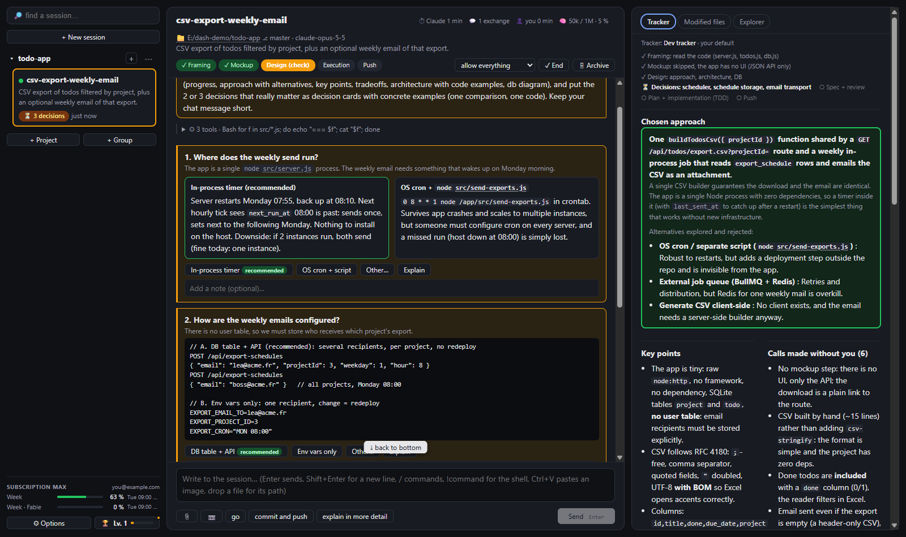

# Claude Dashboard

**Drive all your Claude Code sessions from one page.** See in a few seconds where each session stands, what it is
waiting for, and the design of what it is about to build, instead of scrolling through walls of text in a terminal.



This is a personal tool, built in a few weeks with Claude Code for my own daily work, and published so that **you can
fork it and make it yours**. It is not a product: it is a starting point, deliberately easy to hack.

## Why

When you run several Claude Code sessions in parallel (one per ticket, one per repo…), the expensive part is not
deciding. Claude is right most of the time. The expensive part is **coming back to a session and finding out where it
stands**, and **spotting what really needs you**. I measured it: sessions write 2,000 to 9,000 characters before I
answer "go", "perfect", or "1. yes 2. yes".

So the dashboard flips it around:

- **Summary first, detail within reach.** Each session fills a **Tracker** panel (through an MCP tool it is given):
  progress, chosen approach and rejected alternatives, key points, tradeoffs it made without you, mockups, a UML-style
  architecture view, a database diagram. Nothing is hidden, but you read the summary first.
- **Decisions as cards.** Questions come grouped, each with a recommendation and a concrete example (a scenario,
  before/after code, a side-by-side comparison, a mini mockup). Click, add an optional note, send.
- **Mockup before technical design.** Validating the visual already validates most choices.
- **One fixed layout.** Sessions send data (JSON), never HTML, so every session looks the same.

## What it does

- **Session tree** on the left: projects → git worktrees → sessions, groups, drag and drop, unread counters, a red
  border when a session is blocked on you.
- **Conversation** in the middle: markdown, collapsed tool calls (expandable), decision / question / permission cards,
  subagent and background-shell tabs, a message queue, `!command`, `/` commands with autocompletion, `/mcp`, `/usage`.
- **Tracker** on the right, plus **Modified files** (git status, commits, diffs in Monaco) and an **Explorer** (file
  tree, full-text search with ripgrep, Ctrl+P), with "send this selection to Claude" from the editor.
- **Tracker profiles**: what the panel shows is a JSON profile you can compose with the `/tracker` skill, per repo or
  per installation. Two are built in: a simple one and a "Dev tracker".
- **Sessions that launch sessions** (`launch_session`, `message_session`…), for a coordinator session that hands work to
  workers.
- **Desktop app** (Electron): tray icon that turns red or blue when a session needs you, Windows notifications, start
  with Windows. Quitting the app never stops a session.
- **Phone and remote access**: the page works on mobile; reach it from your wifi, or from the internet behind a login
  (master password + devices you approve), with HTTPS through Caddy.
- **Server mode** (optional): run the whole dashboard in Docker on a server and connect from the browser or the app.
  See [docs/server.md](docs/server.md).
- **Levels and achievements**: the engine counts everything you do (zero tokens) and awards XP, ranks from *Student
  pilot* to *Tower legend*, and 52 achievement families with generated images ("Swarm: 10 subagents in parallel",
  "Night owl", "Eyes closed: follow the recommendation 50 times in a row", and a few secret ones). Open them with the 🏆
  badge next to Options.
- **English and French** interface; the language follows your computer and can be changed in Options.

It uses your **Claude Code subscription** through the official
[Claude Agent SDK](https://www.npmjs.com/package/@anthropic-ai/claude-agent-sdk): no API key. Each session is a real
Claude Code process with your settings, CLAUDE.md, skills, plugins and MCP servers, exactly like in the terminal.

## Install it: let Claude do it

You already have Claude Code. Open it in the folder where you keep your projects and paste this:

```text
Install Claude Dashboard on this machine for me: clone https://github.com/DeepSnowNeeL/claude-dashboard.git
into a "claude-dashboard" folder here, then read its AI-GUIDE.md and follow it step by step (prerequisites,
install, launcher, first start, checks). Ask me before anything that needs administrator rights, and tell me
at the end how to open it.
```

[AI-GUIDE.md](AI-GUIDE.md) is written for that agent: prerequisites, platform differences, checks and troubleshooting.

### Or by hand

Requirements: **Node.js 22 or newer**, **git**, and **Claude Code** installed and logged in (`claude` works in a
terminal). Developed and used daily on Windows 11; macOS and Linux should mostly work but are less tested.

```sh
git clone https://github.com/DeepSnowNeeL/claude-dashboard.git
cd claude-dashboard
npm install
npm run app            # the desktop app (it starts the page server and the engine)
# or, without Electron:
node dash.mjs ensure   # then open http://localhost:4747
```

`npm run launcher` builds a renamed Electron with the app icon and creates Start menu / desktop shortcuts (Windows),
an `.app` (macOS) or a `.desktop` entry (Linux).

## Fork it, make it yours

This is the real point of publishing it. Everyone's workflow is different: your sessions may need a review checklist,
a deploy button, a Jira link, a panel for test results, a cost alarm… **Fork it and ask your Claude to build them.**

Why it is easy to hack:

- **Electron + plain JavaScript, no build step, no framework.** Native ES modules served as is. Change a file in
  `public/`, press F5: done. No bundler, no TypeScript compile, no waiting. This was the simplest way to get features
  fast and to let Claude change the app while I use it.
- **Two processes.** The *engine* holds the sessions; the *page server* serves the UI. Restarting the page never cuts
  a session, and the engine can restart "deferred" (at the end of the current turn), so **a session can safely work on
  the dashboard that drives it**. That is how most of it was built.
- **[CLAUDE.md](CLAUDE.md) is a full architecture guide** for your Claude: layout, data flow, conventions, how to
  restart what. Open a session on your fork and ask for what you want.
- **Small and dependency-light**: three npm dependencies (the Agent SDK, zod, Electron), a tiny signal library for the
  UI, `node:http` for the server.

Some ideas for forks: a Kanban view of sessions, a "review" tracker profile for pull requests, voice input, a panel
that shows CI status, a cost budget per project, Slack/Discord notifications, themes, more languages (add
`public/i18n/<lang>/` and `instructions.<lang>.md`), a macOS menu-bar version, cloning repos from the page in server
mode…

### Show what you built

Built something cool on your fork? **Open an issue with the `showcase` label**: a screenshot or a short video, what it
does, a link to your fork. I read them all, and the ones that would help everyone may well end up merged here.

Bug reports and small fixes are welcome too.

## Security

The dashboard drives Claude Code **with your permissions**: whoever can use the page can make Claude read, write and
run anything your user can. By default everything listens on `127.0.0.1` only.

- *Local network* mode (`node dash.mjs network on`) has **no authentication**: use it only on a network you trust.
- *Remote access* goes through a login (scrypt-hashed master password, then each new device must be approved), an
  `HttpOnly Secure SameSite=Strict` cookie, Origin checks and rate limiting. Still: it is a personal tool, review it
  before exposing it.
- *Server mode*: only the login gate (port 4749) should be reachable, behind your HTTPS reverse proxy. Read
  [docs/server.md](docs/server.md).

## Status

A personal project, shared as is. It relies on some experimental Agent SDK APIs (usage, context) that may change; when
they break, the related blocks just disappear. Not affiliated with Anthropic.

The code was written in French first and translated to English; the French interface is still there.

## License

[MIT](LICENSE)
